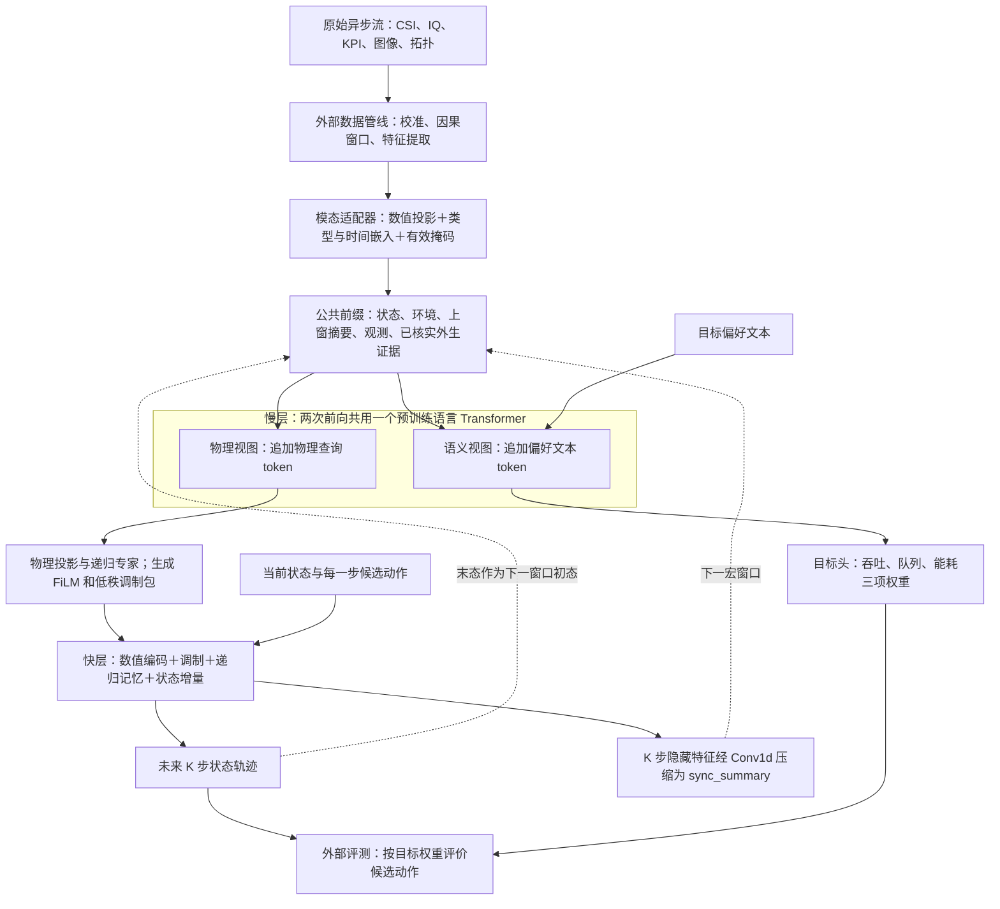

# 模型架构与多时间尺度数据处理

核对日期：2026-10-21；实现依据：[314d2db](https://github.com/xuda1979/-6G-MR-NWM/tree/314d2db)。本页展开[中文论文要点](OVERVIEW_CN.md)中的架构。下面先说明已实现的网络，再给出真实数据接入时需要完成的处理。

## 1. 模型究竟由哪些部分组成

`LanguageBasedWorldModel` 以预训练语言 Transformer 为慢层，以带记忆的轻量递归网络为快层。语言和连续观测在同一嵌入空间中融合；快层直接接收数值状态与动作。连续 CSI、IQ 或图像特征通过模态适配器进入骨干。



图中的外部数据管线、候选动作评测与神经网络具有不同职责。当前参考评测器搜索有限候选集；真实数据的加载器和在线采集调度仍需接入。

| 模块 | 输入 → 输出 | 对应实现与边界 |
|---|---|---|
| 模态适配器 | 每模态 `values: [B,N_m,d_m]` → `[B,N_m,H]` | `TypedModalityEncoder`：Linear/GELU、类型嵌入、时间嵌入；拓扑可加一次归一化邻接消息传递。原始 RF 校准、视觉/点云特征提取在外部完成 |
| 公共前缀 | 状态、环境、上窗摘要、模态 token、可选事实文本 | `LanguageFoundationBackbone.forward`；前三项各投影为一个 token；每个样本的各模态 token 数可以不同，经掩码处理 |
| 两种慢层视图 | 公共前缀＋物理查询；公共前缀＋偏好文本 | 两次前向共用语言模型权重。物理视图不接收偏好文本；物理上下文另外经过 `WirelessSSMExpert.step` |
| 慢→快调制 | 物理上下文 → `gamma/beta/lora_a/lora_b` | FiLM 调整快层特征；低秩因子产生动态残差。此处低秩调制作用于快层，语言骨干的 LoRA 微调尚未实现 |
| 快层状态更新 | `state [B,d_s]`、`action [B,d_a]`、缓存环境与调制包、递归记忆 → 下一状态 | `forward_fast_tier_step`；状态采用增量更新，记忆在同一窗口的 K 步内递推；每一步均不调用语言骨干 |
| 快→慢摘要 | K 个快层隐藏特征 → `sync_summary [B,1,W]` | `Conv1d(kernel_size=K,stride=K)`；`resampler` 是预测特征的反馈压缩器，原始传感器的重采样需在数据管线完成 |
| 任务输出 | `pred_states [B,K,d_s]`、`objective_weights [B,3]` | 默认 `d_s=6,d_a=2,W=32,rank=2,K=5`。六维状态为两路增益、两路队列、两路干扰；两维动作为归一化功率。这些是参考任务的定义 |

`B` 为批量大小，`N_m` 为模态 m 的 token 数，`d_m` 为模态特征维度，`H` 为预训练语言模型嵌入宽度，`W` 为快层宽度。共享开启时，慢层外围的物理专家与快层引用同一组参数；预训练 Transformer 内部层的结构保持原样。两次语言前向目前分别执行，不共享前缀 KV 缓存（`use_cache=False`）。

物理预测与偏好的分工可以写成：

$$
p_n=P_\theta(x_n,c_n,z_n,s_{n-1},e_n),\qquad
w_n=\operatorname{softmax}G_\theta(x_n,c_n,z_n,s_{n-1},e_n,i_n),
$$

$$
(\hat x_{n,k+1},h_{n,k},m_{n,k+1})=
F_\theta(\hat x_{n,k},a_{n,k},c_n,m_{n,k};M(p_n)).
$$

这里 `z_n` 是带时间标记的观测，`e_n` 是已核实外生事实，`i_n` 是目标偏好，`M(p_n)` 是缓存调制包。固定初态、动作和外生条件时，偏好应只改变效用权重。已经实施的动作走动作输入；“希望提高功率”这类请求不能当作已发生事实放入物理证据。

## 2. 多时间尺度包括三种不同的时钟

| 时钟 | 定义 | 模型如何使用 |
|---|---|---|
| 数据采集时钟 | 每模态原生周期 `p_m`，每个 token 的观测时刻 `t_mj` | 各流保持自身时间信息，通过年龄、周期和掩码接入；无需将所有流插值到 CSI 采样率 |
| 慢层刷新时钟 | 第 n 个宏窗口起点 `T_n`，周期 `Δ_s` | 每窗口执行一次慢层更新，内部包含物理/语义两次语言前向，生成本窗口缓存 |
| 快层预测时钟 | 相邻数值预测状态间隔 `δ_f`；每窗口 K 步 | 若使用均匀物理步长，调用者应保证 `Δ_s=K·δ_f`；代码用步号递推，不根据采集周期或 token 年龄自动推断 `δ_f` |

因此，“多时间尺度”包含**异步数据接入**与**两档神经网络执行频率**。目前没有第三个已实现的慢速管理控制器。参考基准的 `K=5` 为离散实验设置，未换算成无线系统中的毫秒。

## 3. 不同频率的数据怎样进入同一次慢层更新

在慢层时刻 `T_n`，为模态 m 的每个 token 记录：

$$
\mathrm{age}_{m,j}=T_n-t_{m,j},\qquad
v_{m,j}=\mathrm{observed}_{m,j}\land(\mathrm{age}_{m,j}\ge0)
\land(\mathrm{age}_{m,j}\le\mathrm{TTL}_m).
$$

最后一项仅在配置 `max_age_seconds` 时使用。代码拒绝被标记为有效却来自未来的观测；缺失与过期 token 不参与注意力。相应图节点的入边和出边也被屏蔽。`period_seconds` 描述采集周期，过期阈值由应用另行设置。

不带图边的 token 编码为：

$$
z_{m,j}=\mathrm{GELU}(W_m x_{m,j}+b_m)+e_m+
W_t[\log(1+\mathrm{age}_{m,j}),\log(1+p_m)]+b_t.
$$

时间统一以秒表示。拓扑输入可在时间/类型嵌入前加入有效邻居消息；其归一化只使用有效节点。年龄对数和图权重归一化先以至少 FP32 计算，再转换模型精度。数值校准和训练集归一化须在数据管线完成。

真实数据接入建议按以下顺序执行；其中时间对齐、窗口选取与特征压缩均属于**待接入的数据管线**：

1. **统一时间与实体。** 记录 `episode_id/entity_id/event_time/arrival_time`、单位、时区、时钟偏差和原始文件来源；在 `T_n` 只允许使用事件已发生且数据已到达的观测。聚合 KPI 用统计区间结束时间计算年龄，禁止用包含未来信息的居中窗口。
2. **保留各自原生速率。** 对高频 CSI/IQ 使用截至 `T_n` 的尾随窗口，按任务保留若干有序块/统计特征；降采样前考虑抗混叠。图像、雷达、点云先提取适量连续特征。低频 KPI/拓扑可取最近有效值或短历史，同时保留其真实年龄。
3. **形成每模态 token。** 每个 token 有值、年龄与有效位；一段窗口的摘要用该窗口结束时刻作时间标记，额外的窗口长度/统计量可作为数值特征。缺失流允许省略；缺失 token 显式标 `valid=False`，避免将补零误认作真实零测量。当前每模态周期是一个正标量；不规则采样仍需逐 token 计算真实年龄，并记录周期的约定。
4. **控制输入预算。** 先确定各模态 token 上限，再保留历史或池化；两种视图均受 `max_tokens` 限制（默认 512，包含状态/环境/摘要及文本）。模型超限报错；不会自动抽样、截断或按重要性选择数据。
5. **慢层融合、快层递推。** 各模态以类型、年龄、周期和掩码在语言骨干中交互；本窗口 K 步复用同一调制包。不同快步通过动作和递归记忆产生不同预测。`age/period` 在当前实现中不作为每个快步的独立输入。

同一个场景中有时间对应关系的流才能做同步融合。不同城市、设备、日期的数据集可分任务预训练共享骨干/适配器；不能按行拼接成一段声称同步的多模态轨迹。

## 4. 一个时间对齐示例

假设慢层在 `T_n=10.000 s` 刷新。以下周期和 TTL **仅用于解释算法**，不代表数据集参数或已达到的推理时限。

| 流 | 采集周期 | 最近观测时刻 | 当前年龄 | 应用设置的 TTL | 此次进入模型 |
|---|---:|---:|---:|---:|---|
| CSI 特征 | 1 ms | 9.999 s | 1 ms | 5 ms | 有效 |
| 图像特征 | 50 ms | 9.970 s | 30 ms | 100 ms | 有效 |
| KPI | 100 ms | 9.900 s | 100 ms | 500 ms | 有效 |
| 拓扑 | 1 s | 9.200 s | 800 ms | 2 s | 有效 |

若 `K=5,δ_f=20 ms,Δ_s=100 ms`，一次慢层更新随后产生 5 个数值预测。到 `T_{n+1}=10.100 s`：

- **固定快照预测：**没有读入新测量，各年龄增加 100 ms；CSI 为 101 ms、图像为 130 ms，两者在下一次编码时过期；KPI 与拓扑仍有效。
- **流式更新：**数据管线装入新到达的测量，例如 `10.099 s` 的 CSI，其年龄重新按时间戳计算为 1 ms；继续使用旧拓扑时，其年龄为 900 ms。

当前过期检查发生在慢层编码时，窗口内部不会逐快步重新检查 TTL。本例 CSI 在宏窗口内很快会变旧；若控制任务要求每一步使用新鲜 CSI，上层必须选更短的窗口，或接入事件触发刷新与过期回退策略。后两项在线调度尚未实现，100 ms 的示例不能用于证明此类控制满足时限。

## 5. 跨窗口状态与新数据如何更新

已有 `rollout` 面向固定观测快照：

```python
# 已构造 model / inputs / initial / actions / context。
# 每个宏窗口 5 步，动作长度必须为 5 的正整数倍。
trajectory = model.rollout(
    inputs,
    initial,
    actions,
    context,
    macro_period_seconds=0.1,
)
```

代码在第 n 个窗口使用 `inputs.advance(n * macro_period_seconds)`，只推进观测年龄，同时传递预测末态和摘要。存在多模态且跨多个窗口时，必须给出宏窗口物理时长；固定快照不会生成未来传感器测量，也不会刷新外生证据。

流式测量需由调用者逐窗口传入：

```python
# collect_window 是外部采集/时间对齐接口，仓库尚未提供其实现。
state, summary = initial, None
for window in windows:
    inputs, context, actions = collect_window(window)
    output = model(inputs, state, actions, context, summary)
    state = output["pred_states"][:, -1]
    summary = output["sync_summary"]
```

每次 `forward` 的快层记忆从零开始；跨窗口传递的是末态和压缩摘要，完整快层记忆不直接跨窗延续。在线获得真实状态时，可由外部状态估计器校正下一窗口初态；评测自由滚动误差时必须持续传递预测末态，避免用真实初态掩盖累积误差。

## 6. 当前能力与真实数据训练的边界

| 已在当前代码实现 | 真实数据接入/后续研究仍需完成 |
|---|---|
| 连续模态投影、时间/类型编码、掩码、可选拓扑消息传递 | 数据集解析、RF 校准、图像/点云编码、因果重采样、时钟与到达时间对齐 |
| 语言骨干两种视图、慢→快调制、K 步缓存快层 | 针对真实测量训练适配器和预测头，检验预训练与共享机制的贡献 |
| 固定快照年龄推进、跨窗末态与摘要反馈 | 流式采集器、窗口中途事件刷新、丢包/过期回退、硬件端到端时延验证 |
| 默认六维连续状态及三目标输出；参考功率候选评测 | 按数据字段重定义状态/动作、增加波束/遮挡等任务头及损失；实际控制动作与结果的时间对齐 |

真实数据的选择、可训练任务与授权条件见[公开免费真实数据集](REAL_DATASETS_CN.md)。现有论文性能表仍对应合成数据上的轻量模型；本次文档补充未产生新的训练结果。

## 7. 源码核对入口

- [foundation.py](../src/mr_nwm/foundation.py)：预训练骨干、双视图、慢层调制、`FoundationInputs.advance`、固定快照多窗预测。
- [modalities.py](../src/mr_nwm/modalities.py)：输入字段、时间特征、有效/过期掩码、图边和精度处理。
- [model.py](../src/mr_nwm/model.py)：`ModelConfig`、快层增量、递归记忆、摘要压缩、跨窗传递。
- [experts.py](../src/mr_nwm/experts.py)：共享物理专家、门控记忆和动态低秩残差。
- [英文接口说明](LANGUAGE_FOUNDATION.md)、[论文架构章节](../paper/language_foundation.tex)：公式和实现边界。
