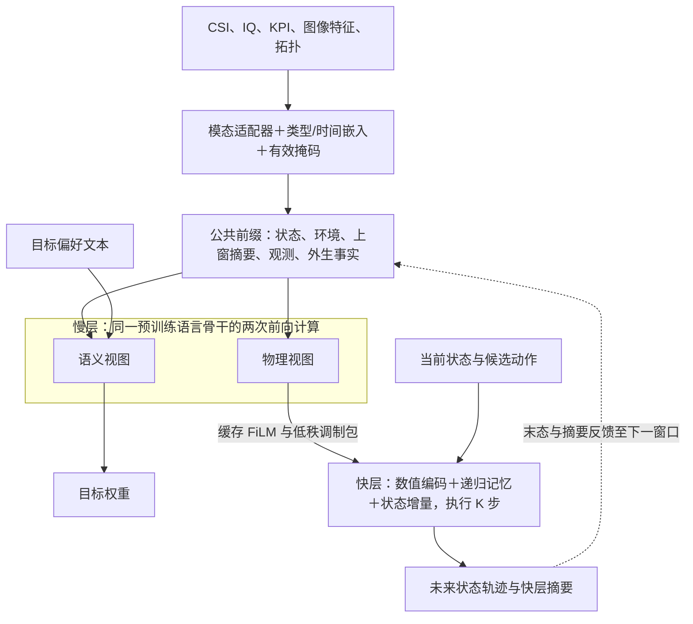

# MR-NWM 论文要点

核对日期：2026-10-21；当前实现依据：[314d2db](https://github.com/xuda1979/-6G-MR-NWM/tree/314d2db)。实验结果沿用原始记录，不因文档更新改变。

**核心思路：以预训练语言模型作为慢速共享骨干，融合文本与连续观测，编译控制目标；再由轻量递归子网根据候选动作预测网络状态。** 当前有语言基座实现和轻量参考实现，两者的验证范围见下表。

## 1. 研究问题

无线接入网（RAN）的控制需要同时回答：运营者重视吞吐量、排队还是能耗？给定动作后，网络将怎样变化？不同传感数据的采样速度不同，语言模型与数值预测的计算开销也不同。本文研究如何把这些信息与计算连接起来，并检验共享参数和跨尺度训练是否有益。

基本关系是：`下一状态 = F(当前状态, 动作, 外生条件)`，`动作效用 = 目标权重 · 预测结果的指标`。例如“更重视节能”会改变动作评分；在初态、动作和外生条件固定时，偏好文字应保持物理预测不变。已经发生的配置变化等事实需单独作为经过核实的外生证据输入。

## 2. 模型输入与输出

| 类型 | 内容与表示 | 当前实现范围 |
|---|---|---|
| 输入：目标文本 | 吞吐、排队、能耗等偏好 | 语言版本使用预训练分词器；参考实验使用受控词表 |
| 输入：状态与环境 | 连续数值状态、业务负载及外生条件；可附外生证据文本 | 两条实现均接收数值；独立证据文本字段在语言版本中实现 |
| 输入：多模态观测 | 信道状态信息（CSI）、同相／正交（IQ）特征、业务／性能序列、拓扑节点；可配置地图／图像特征块 | 语言版本经可训练适配器投影为连续 token；CSI/IQ 实虚部构造、射频校准及图像特征提取由外部完成 |
| 输入：时间与有效性 | 观测年龄、采样周期、有效掩码；可设过期阈值 | 标记异步与缺失观测，支持过期屏蔽；时钟同步由外部完成 |
| 输入：候选动作 | 待评估的数值动作序列 | 参考实验为两条链路的归一化发射功率 |
| 输出：物理预测 | `pred_states`：未来连续状态轨迹 | 默认六维状态为两路增益、两路队列、两路干扰；单窗口形状为 `[批量, K, 6]` |
| 输出：目标与反馈 | `objective_weights`：三项目标权重；`sync_summary`：快层摘要 | 摘要和预测末态传入下一窗口；参考评测组件另外计算有限候选集内的决策损失 |

当前通用自然语言解释与任意协议动作生成仍待实现。队列长度在参考实验中用作时延相关代理量。

## 3. 架构与方法

### 3.1 从各模态输入到预测输出

每个模态将 `[批量, token数, 特征维度]` 投影到语言骨干的嵌入宽度，加入模态类型、观测年龄和采集周期；拓扑可先聚合有效邻居。语义视图产生目标权重；物理视图产生 FiLM（特征缩放/平移）和动态低秩残差包，用于调制快层。共享开启时，慢层外围的物理专家与快层使用相同参数。快层每步接收数值状态和动作，不调用语言骨干。语言骨干自身的 LoRA 微调另待实现。

### 3.2 多时间尺度的数据怎样处理

| 三种时钟 | 处理方式 |
|---|---|
| 各流采集周期 `p_m` | 保留原生速率；数据管线选取截至当前时刻的历史特征，每个 token 记录年龄、周期与有效位 |
| 慢层宏窗口 `Δ_s` | 每窗口执行物理/语义两次语言前向，融合不同年龄的观测并缓存调制包 |
| 快层步长 `δ_f` | 窗口内执行 K 次递归；均匀物理步长时由调用者保证 `Δ_s=K·δ_f`，代码不会从采集周期自动推断快层步长 |

在慢层时刻 `T`，观测年龄为 `T−观测时间`。例如 CSI、图像和拓扑分别已过去 1 ms、30 ms、800 ms，仍可在同一窗口融合；输入同时带 `log(1+年龄)`、`log(1+周期)` 的时间嵌入。缺失观测被屏蔽，配置 TTL 后过期观测及其图边也被屏蔽。未来有效观测会被拒绝。

**跨窗口有两种方式：**固定快照 `rollout` 按 `macro_period_seconds` 增加年龄，传递预测末态与压缩摘要；流式运行由调用者在下一窗口重新传入新观测并重算年龄。完整快层记忆不直接跨窗传递。过期检查发生在慢层编码时，窗口中途的新数据/过期事件尚无自动调度。原始流的时钟同步、抗混叠、降采样/特征窗口和超长输入压缩均需外部数据管线完成；代码中的 `resampler` 压缩快层预测特征以形成反馈摘要。

### 3.3 跨尺度训练

轻量参考模型联合优化轨迹误差、目标权重交叉熵和路由正则；连续预测两个窗口，传递预测末态与摘要，并截断部分反向传播历史。参考设置 K=5，总计 10 步；该步数未标定为实际无线时间。各模块张量、缓存内容、时间对齐数值示例及调用方式见[架构与多时间尺度详解](ARCHITECTURE_CN.md)。

## 4. 贡献与创新边界

本文的贡献集中在上述机制的组合：将语言与连续观测融合、偏好／动力学因果隔离、缓存快层和可选参数共享放入可检验的系统。跨窗口反馈避免每个窗口重新使用真实初态掩盖累积误差；独立递归模型、参数量相近的 MLP 及共享／调制／梯度消融用于检验各机制的增益。

FiLM、低秩参数化、多速率递归及专家混合已有研究基础。现有结果支持系统与实验流程可运行；共享参数、跨尺度梯度与语言预训练各自的普遍收益仍需验证。轻量参考模型执行全部专家，未实现稀疏 MoE 加速。

## 5. 数据、结果与下一步

| 实现 | 当前证据 | 结论范围 |
|---|---|---|
| 语言基座 `LanguageBasedWorldModel` | 已记录 Qwen2.5-0.5B 的 CSI/IQ/拓扑接入、冻结骨干下适配器梯度及偏好不变性检查 | 适配器与无线预测头尚未完成任务训练；暂无无线预测性能结论 |
| 轻量参考 `MultiRateNestedWorldModel` | 自建双链路队列／干扰模拟器；8 个变体、3 个初始化种子、每个可训练模型 300 次更新 | 论文性能表仅对应此实现与合成数据；仓库未提供真实无线测量数据 |

参考实验的信号能量归一化均方误差（NMSE，dB，越低越好）如下；数值为三种子的均值 ± 样本标准差。同分布（IID）与分布外（OOD）使用同一套评测协议。

| 模型 | IID NMSE | OOD NMSE |
|---|---:|---:|
| MR-NWM 共享版 | -22.24 ± 0.20 | -9.58 ± 0.41 |
| 参数量相近的 MLP | -14.92 ± 0.35 | -7.15 ± 0.70 |
| 独立递归模型 | -21.19 ± 0.30 | -9.43 ± 0.37 |

共享版优于该 MLP 对照；与独立递归模型的 OOD 均值接近。受限语法的精确词典基线优于学习式目标解析，开放语言理解价值仍需另外评测。功率约束由候选动作过滤保证。现有主机时延测量仅属于轻量模型，实际基站端到端时限、长期闭环控制及通用安全性仍待验证。

### 公开免费的真实训练数据

以下为已核对的候选入口；许可、采样信息、输入/标签映射和下载检查见[真实数据集详表](REAL_DATASETS_CN.md)。

| 数据集 | 可训练部分与主要条件 |
|---|---|
| [DeepSense 6G](https://www.deepsense6g.net/) | 真实多模态无线/感知；适配器、波束/遮挡预测；按场景核对模态和非商业许可 |
| [DICHASUS](https://dichasus.inue.uni-stuttgart.de/datasets/) | 实测 CSI＋位置/时间；信道表征、定位、连续轨迹预测；示例数据为 CC BY 4.0 |
| [UCC 5Gdataset](https://github.com/uccmisl/5Gdataset) | 商用网秒级 KPI；只选 production ZIP，排除同仓库 ns-3 输出；数据许可另需复核 |
| [Lumos5G](https://networking.umn.edu/lumos5g) | 实测毫米波 5G 吞吐与上下文；官方公开下载，数据许可待复核 |
| [5G-IANA UC6](https://zenodo.org/records/10037164) | 实测吞吐、RTT、无线 KPI；CC BY 4.0；已下载核对，含缺失值、重复时间与异常位置 |
| [5G-IANA Nokia 路测](https://zenodo.org/records/12664724) | 实测位置/吞吐/PING KML；CC BY 4.0；已核对字段，三份文件为同组数据的展示副本，需去重且处理缺失 PING |
| [Telecom Italia Milan](https://dataverse.harvard.edu/dataset.xhtml?persistentId=doi:10.7910/DVN/EGZHFV) | 真实 10 分钟聚合业务活动；慢尺度负载表征；ODbL，活动强度不等于比特率 |
| [WiSig](https://cores.ee.ucla.edu/downloads/datasets/wisig/) | 实测 WiFi IQ；表征预训练/射频指纹；CC BY-NC-SA 4.0，包级标签不构成蜂窝动力学轨迹 |

优先用 UC6 跑通真实 KPI 预测，再接 DICHASUS 与 DeepSense 的连续/多模态训练。需按数据字段调整状态定义、任务头和损失；这些数据尚未接入仓库。完整动作条件模型仍需有时间对齐的真实动作与后续状态日志。不同数据集可分任务训练，不能拼成虚假的同步轨迹。可选 flow matching 概率头未用于现有基准，其概率校准收益仍待评估。

## 6. 来源与维护

| 核对内容 | 仓库来源 |
|---|---|
| 问题、方法及贡献 | [论文正文](../paper/main.tex)、[语言架构章节](../paper/language_foundation.tex)、[结果讨论](../paper/discussion.tex) |
| 模型接口与多模态边界 | [语言模型实现](../src/mr_nwm/foundation.py)、[多模态适配器](../src/mr_nwm/modalities.py)、[参考模型](../src/mr_nwm/model.py)、[接口说明](LANGUAGE_FOUNDATION.md) |
| 架构、三种时钟与真实数据接入 | [架构与时间处理](ARCHITECTURE_CN.md)、[公开免费真实数据集](REAL_DATASETS_CN.md) |
| 数据、训练及决策评测 | [数据生成](../src/mr_nwm/data.py)、[训练评测](../src/mr_nwm/experiment.py)、[候选评测](../src/mr_nwm/planning.py) |
| 实测结果与验证范围 | [结果摘要](../results/SUMMARY.md)、[原始指标](../results/metrics.json)、[语言接入记录](../results/pretrained_integration.json)、[复现协议](REPRODUCIBILITY.md) |

保持本文件为中文要点的统一入口。论文结论、模型输入／输出／架构、数据来源或已验证结果变化时，在同一 PR 同步相关段落与核对日期／版本；实验数值沿用可追溯的结果记录，保留所属实现和验证条件。仅做文档核对时保留原始实验记录。篇幅保持约 3–5 分钟可读，详细推导与操作步骤通过链接展开。
