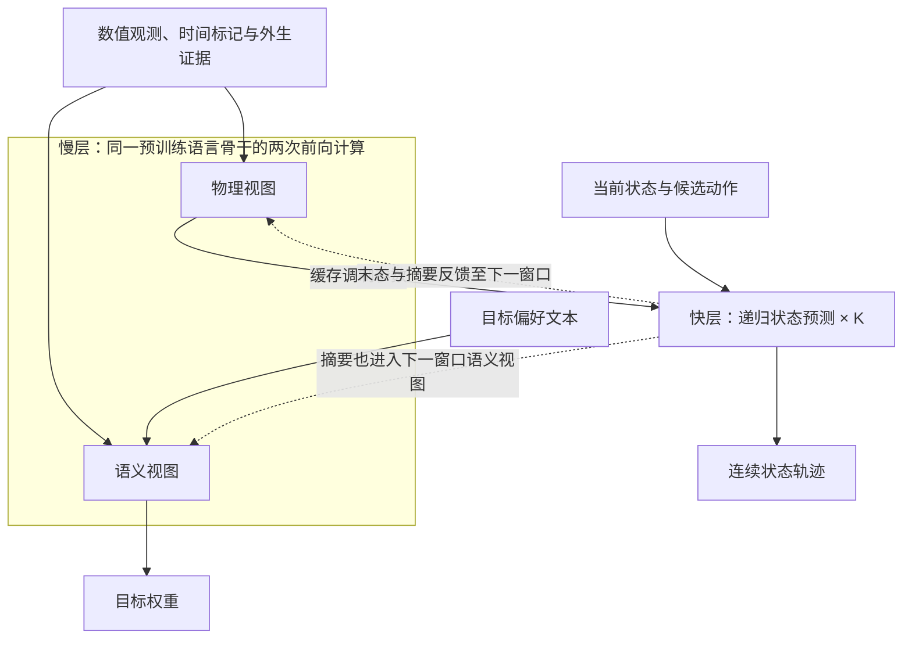

# MR-NWM 论文要点

核对日期：2026-10-21；代码基线：[314d2db](https://github.com/xuda1979/-6G-MR-NWM/tree/314d2db3ad4f5c62a5c15c0008d8fee0353f8cb9)；新增实验依据：[公开数据训练契约](../results/public_data/EXPERIMENT_CONTRACT.json)。

**核心思路：以预训练语言模型作为慢速共享骨干，融合文本与连续观测，编译控制目标；再由轻量递归子网根据候选动作预测网络状态。** 当前有语言基座实现和轻量参考实现，两者的验证范围见下表。

## 1. 研究问题

无线接入网（RAN）的控制需要同时回答：运营者重视吞吐量、排队还是能耗？给定动作后，网络将怎样变化？不同传感数据的采样速度不同，语言模型与数值预测的计算开销也不同。本文研究如何把这些信息与计算连接起来，并检验共享参数和跨尺度训练是否有益。

基本关系是：`下一状态 = F(当前状态, 动作, 外生条件)`，`动作效用 = 目标权重 · 预测结果的指标`。例如“更重视节能”会改变动作评分；在初态、动作和外生条件固定时，偏好文字应保持物理预测不变。已经发生的配置变化等事实需单独作为经过核实的外生证据输入。

## 2. 模型输入与输出

| 类型 | 内容与表示 | 当前实现范围 |
|---|---|---|
| 输入：目标文本 | 吞吐、排队、能耗等偏好 | 语言版本使用预训练分词器；参考实验使用受控词表 |
| 输入：状态与环境 | 连续数值状态、业务负载及外生条件；可附外生证据文本 | 两条实现均接收数值；独立证据文本字段在语言版本中实现 |
| 输入：多模态观测 | 信道状态信息（CSI）、同相／正交（IQ）特征、业务／性能序列、拓扑节点；可配置地图／图像特征块 | 语言版本经可训练适配器投影为连续 token；CSI/IQ 实虚部构造、射频校准及图像特征提取由外部完成 |
| 输入：时间与有效性 | 观测年龄、采样周期、有效掩码；可设过期阈值 | 标记异步与缺失观测，支持过期屏蔽；时钟同步由外部完成 |
| 输入：候选动作 | 待评估的数值动作序列 | 参考实验为两条链路的归一化发射功率 |
| 输出：物理预测 | `pred_states`：未来连续状态轨迹 | 合成实验输出六维增益／队列／干扰；公开数据任务输出单目标的五步吞吐量或时延 |
| 输出：目标与反馈 | `objective_weights`：三项目标权重；`sync_summary`：快层摘要 | 摘要和预测末态传入下一窗口；参考评测组件另外计算有限候选集内的决策损失 |

当前通用自然语言解释与任意协议动作生成仍待实现。队列长度在参考实验中用作时延相关代理量。

## 3. 架构与方法

- **多模态融合：**连续数据经各模态适配器进入语言骨干；拓扑可先做归一化邻接消息传递。两种视图共用语言模型参数，物理视图隔离目标偏好。
- **多速率计算：**区分观测采样周期、慢层刷新周期和快层预测步长。每个宏窗口计算一次慢层（包含两种视图），快层复用缓存完成 K 步；快层不调用语言模型。当前实现两档神经网络执行速率。
- **上下文调制与共享：**慢层产生 FiLM（特征缩放与平移）和动态低秩残差参数，调节快层递归计算；慢、快层可共享物理专家。这里的低秩更新作用于快层，语言骨干自身的 LoRA 微调另待实现。
- **跨窗口训练：**轻量参考模型联合优化轨迹误差、目标权重交叉熵和路由正则；连续预测两个窗口，传递预测末态与摘要，并截断部分反向传播历史。参考设置 K=5，总计 10 步；该步数未标定为实际无线时间。

## 4. 贡献与创新边界

本文的贡献集中在上述机制的组合：将语言与连续观测融合、偏好／动力学因果隔离、缓存快层和可选参数共享放入可检验的系统。跨窗口反馈避免每个窗口重新使用真实初态掩盖累积误差；独立递归模型、参数量相近的 MLP 及共享／调制／梯度消融用于检验各机制的增益。

FiLM、低秩参数化、多速率递归及专家混合已有研究基础。现有结果支持系统与实验流程可运行；共享参数、跨尺度梯度与语言预训练各自的普遍收益仍需验证。轻量参考模型执行全部专家，未实现稀疏 MoE 加速。

## 5. 数据、结果与下一步

**新增三套免费公开实测数据训练：UCC4G、UCC5G 与 CICV5G。** 共下载约 51.9 万条原始记录，清洗后训练窗口为 1,358／4,110／18,053。输入为八步历史吞吐量或时延、RSRP、SNR／SINR、速度及缺失掩码，预测后五步。记录先去重并按完整采集组划分，归一化只拟合训练集；缺失目标和大时间间隙被剔除。

语言版本使用冻结的 SmolLM2-135M，训练数值适配器、调制与快层；比较相同历史信息下的数值 MR-NWM、持久预测和岭回归。两个学习模型各运行三种子、300 次更新，每批八个样本；实际接触样本量另有记录，尚不能宣称充分收敛。验证集选择检查点，再评测固定测试窗口（分别 229／512／512 个）。MAE 越低越好；单位分别为 Mbps、Mbps、ms。

<!-- BEGIN_PUBLIC_RESULTS -->
结果表由 `scripts/report_public.py` 从原始实验记录生成。
<!-- END_PUBLIC_RESULTS -->

这些数据没有功率／PRB 干预标签或偏好监督，动作字段为零占位，结果支持观测预测。原有双链路合成控制实验及 Qwen 接入检查独立保留；合成共享版 IID/OOD NMSE 为 -22.24／-9.58 dB，不能与新增 MAE 混用。共享、跨尺度梯度和语言预训练各自的普遍增益仍待更强对照。

下一步：扩展训练覆盖和不同站点／场景验证，引入带有效干预记录的数据，再检验长期闭环收益与目标硬件时延。原始 CSI/IQ、图像与通用偏好解析尚未在本次公开数据任务中训练。

## 6. 来源与维护

| 核对内容 | 仓库来源 |
|---|---|
| 问题、方法及贡献 | [论文正文](../paper/main.tex)、[语言架构章节](../paper/language_foundation.tex)、[结果讨论](../paper/discussion.tex) |
| 模型接口与多模态边界 | [语言模型实现](../src/mr_nwm/foundation.py)、[多模态适配器](../src/mr_nwm/modalities.py)、[参考模型](../src/mr_nwm/model.py)、[接口说明](LANGUAGE_FOUNDATION.md) |
| 数据与训练 | [公开数据协议](PUBLIC_DATA.md)、[数据管线](../src/mr_nwm/public_data.py)、[预测训练](../src/mr_nwm/public_forecast.py)；[原合成实验](../src/mr_nwm/experiment.py) |
| 结果与验证范围 | [实测结果摘要](../results/public_data/SUMMARY.md)、[论文实测章节](../paper/public_data.tex)、[原合成结果](../results/SUMMARY.md)、[复现协议](REPRODUCIBILITY.md) |

保持本文件为中文要点的统一入口。论文结论、模型输入／输出／架构、数据来源或已验证结果变化时，在同一 PR 同步相关段落与核对日期／版本；实验数值沿用可追溯的结果记录，保留所属实现和验证条件。仅做文档核对时保留原始实验记录。篇幅保持约 3–5 分钟可读，详细推导与操作步骤通过链接展开。
