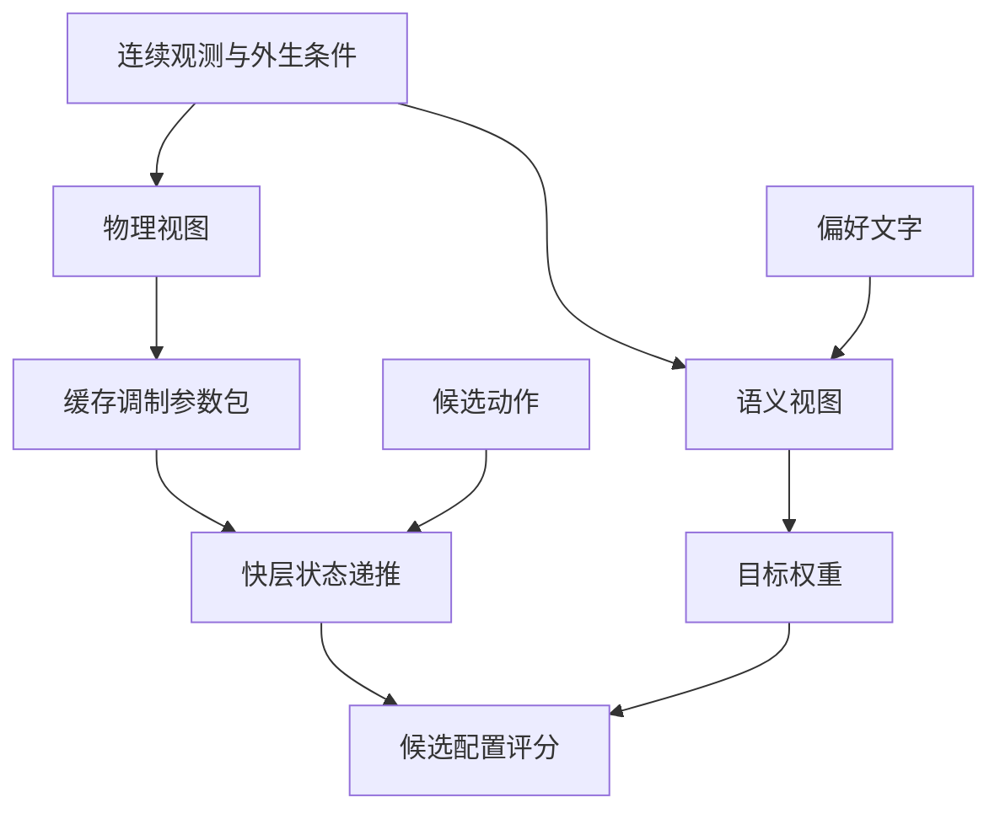
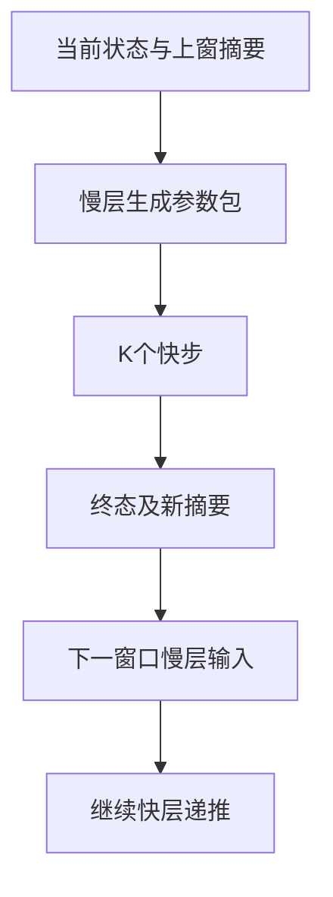
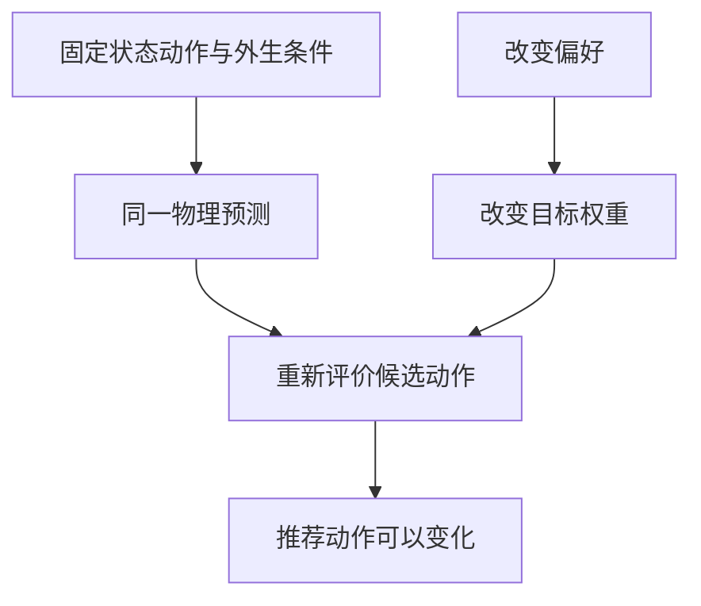

发明专利技术交底书
一种多模态多速率无线网络世界模型控制方法
编制单位：中国移动通信有限公司研究院
编制日期：2026-10-16

# 发明名称
一种多模态多速率无线网络世界模型控制方法。

英文名称：Multimodal Multi Rate Wireless Network World Model Control Method。

# 申请人信息
| 字段 | 内容 |
|---|---|
| 拟申请人名称 | 中国移动通信有限公司研究院 |
| 申请人类型 | 院内核定 |
| 国籍或注册地 | 院内核定 |
| 统一社会信用代码 | 院内填写 |
| 通讯地址 | 院内填写 |
| 邮政编码 | 院内填写 |
| 联系电话 | 院内填写 |
| 电子邮箱 | 院内填写 |

申请主体及职务发明归属由院内核定。

# 发明人信息
## 第一发明人
| 字段 | 内容 |
|---|---|
| 姓名 |  |
| 国籍 |  |
| 工作单位 |  |
| 职务或职称 |  |
| 通讯地址 |  |
| 邮政编码 |  |
| 联系电话 |  |
| 电子邮箱 |  |

其他发明人：________________。发明人及排序按实际创造性贡献确认。

# 技术领域
本发明涉及无线通信网络控制、人工智能和动态系统建模，尤其涉及将多模态网络观测接入预训练语言模型，在不同执行速率下预测候选资源配置的网络状态，并将运营偏好与物理状态转移分离的计算机实现方法。适用于5G及6G无线接入网的功率配置、资源分配和策略仿真。

# 背景技术
## 现有技术的局限性
无线网络数字孪生、动作条件世界模型、多模态语言模型及快慢控制均已有公开。CN120935780A公开语言模型调度与周期性反思；WO2026071644A1公开融合多域数据的网络数字孪生配置推荐；论文Telecom World Models已提出基础模型意图层与动力学层。单独使用上述概念不足以体现本案区别，详见配套检索报告。

## 多模态观测与不同执行速率问题
信道状态信息CSI、同相正交IQ采样、业务指标及拓扑具有不同采样周期和时效性。将连续观测全部转成文本会增加表示长度；每个快步重复调用语言主干会重复处理相同慢变上下文。需要在保留连续值和观测时间信息的同时，用可缓存的慢层输出驱动多个快步。

## 运营偏好与物理状态预测的区分
“优先节能”是评价动作的偏好，不代表信道或负载已改变。若偏好直接进入动力学预测，模型可能仅因目标文字变化而预测不同信道和队列。实际配置变化应通过动作或已观测的外生条件进入。两类信息须在计算路径上分开，并在动作评分时汇合。

# 发明内容
## 发明目的
本发明通过共享语言主干的两个输入视图、慢层调制参数包和窗口内快层递推，降低重复主干调用，并约束偏好信息进入物理预测的路径。预测轨迹用于比较候选无线资源配置；是否满足实际控制时限由目标设备实测确定。

## 技术方案
定义快步间隔为Δt，每K个快步形成一个慢窗口，慢层更新间隔ΔT=KΔt；各观测模态另有采样周期ρ。系统包括多模态编码器、共享预训练语言主干、物理投影与偏好目标头、调制参数生成器、快层循环预测器、窗口摘要器及候选配置评价器。

### 技术特征 A 多模态连续编码与时间有效性处理
对每个模态提供连续特征x、相对当前慢层更新时间的观测年龄δ、采样周期ρ和有效掩码v。CSI及IQ使用实部和虚部特征，拓扑使用节点特征与可选邻接矩阵。编码器按模态分别投影并加入模态标识、log1p年龄和周期嵌入；无效观测置零且在注意力中屏蔽。拒绝有效数据中的非有限值、负年龄及非正周期。图数据可在有效节点之间作一次行归一化消息传递；缺少整个模态时省略其令牌。

### 技术特征 B 共享语言主干的物理视图与语义视图
同一组语言主干参数执行两个独立前向过程。物理视图仅含当前状态、外生条件、上一窗口摘要、多模态观测及调用方提供的外生证据，附加物理查询令牌并读取其隐藏向量；语义视图在共同观测后附加偏好令牌，读取最后一个有效偏好位置并输出吞吐量、队列和能耗三个目标的归一化权重。物理前向不接收偏好令牌、其隐藏状态或语义视图缓存。外生证据与偏好由调用方分字段提供，接口不自动判别文本内容的真实性。

### 技术特征 C 由物理上下文生成窗口调制参数包
物理向量经投影和循环物理算子后，生成γ、β以及低秩矩阵A、B。设快层宽度为d、秩为r，则γ、β为d维，A、B均为d乘r；以1+0.1tanh和0.1tanh分别限制缩放及其余参数幅度。参数包含外生条件，在一个窗口的K个快步内缓存复用。目标权重只供评分，快层不读取该字段。这里的低秩项是输入相关的特征残差，不改写语言主干权重。

### 技术特征 D 使用缓存参数包的动作条件递推
每步输入当前预测状态s、候选动作a及外生条件c。先投影并调制输入u，再用显式记忆m执行门控循环运算G，输出下一状态；仅记忆m和预测状态逐步推进，窗口内不调用语言主干。

$$u_t=\gamma\odot\operatorname{SiLU}(W_x[s_t;a_t;c]+b_x)+\beta$$

$$y_t=G_\theta(u_t,m_t)+\operatorname{Norm}(u_t)AB^\mathsf{T}/\sqrt{r}$$

$$s_{t+1}=s_t+W_\delta y_t+b_\delta$$

G具体为：归一化u，线性映射获得输入分支与门控分支；输入分支经SiLU后生成sigmoid衰减系数q和tanh写入值z；更新m=q⊙m+(1−q)⊙z，将m线性读出后与门控分支相乘，线性投影并与u残差相加。低秩项按先乘A再乘B转置计算，无需形成d乘d矩阵。

### 技术特征 E 窗口反馈与候选配置评价
将K个快步的隐藏输出按时间排列，利用卷积核长和步长均为K的一维卷积得到一个窗口摘要。下一窗口使用前一窗口终态及摘要重新生成参数包，保持自由递推连续性。预测阶段终态来自模型；在线部署时可由新实测状态校正。对满足已知硬配置边界的有限候选动作分别预测，以目标权重对预测指标评分并输出推荐动作；硬过滤只保证所检查的配置边界。

### 技术特征 F 可选算子共享与跨尺度训练
慢层物理投影后的循环算子与快层G可引用同一参数对象。共享范围为该外围循环算子，语言Transformer内部层不作共享改造。可冻结语言主干权重，但保留经过主干到连续适配器的反向传播。训练使用状态预测损失和目标权重监督损失，跨多个窗口展开；可在固定快步间隔截断状态与记忆梯度。算子共享与是否截断慢快桥接梯度分别配置。

# 附图说明
图1示出连续观测、共享语言主干双视图、缓存参数包及候选评分的数据流；图2示出两个连续窗口的状态和摘要推进；图3示出偏好干预时的物理不变路径与动作评分路径。

# 具体实施方式
## 系统架构
代码对应src/mr_nwm中的modalities.py、foundation.py、model.py、experts.py及planning.py。复核版本为c22ec3c97919463878470ad131b4473e6cd1b25b。预训练语言路径实现多模态接入及双视图；轻量参考路径用于已提交的合成实验，两条路径的结果分别记录。

## 实施步骤
### 实施例 1 多模态接入与语言主干更新
注册csi、iq及topology的输入特征维数。采集观测、观测年龄和周期；复数先拆分实虚部，图邻接去除无效节点连接并归一化。将连续令牌与状态、外生条件和摘要投影拼接，输入同一预训练语言主干的两个独立前向。超出慢层令牌预算时由调用方先池化或重采样，接口拒绝超额输入。冻结主干时不使用全局无梯度包装，保证适配器可训练。

### 实施例 2 连续两窗口的无线状态预测
取状态维数6、动作维数2、外生条件维数4、d=32、记忆维数16、r=2、K=5。六维状态依次为两链路增益、队列和干扰；动作是两链路归一化功率；外生条件为到达负载、交叉增益和移动性。首窗记忆为零，执行5步后以卷积压缩隐藏序列；以第5步预测终态和摘要启动第二窗，窗内记忆重新初始化。训练可每3步截断梯度。语言模型接入记录使用Qwen2.5-0.5B，已验证CSI、IQ及拓扑令牌接入、五步输出、冻结主干时的适配器梯度及偏好不变性；适配器和预测头尚未完成无线任务训练。

### 实施例 3 偏好干预与有限候选动作审计
固定状态、观测、外生条件和候选动作，分别输入吞吐优先与能耗优先文字；在确定性推理设置下，物理参数包和轨迹应一致，评分权重可变化。改变已观测交叉干扰或动作后，物理预测允许变化。合成审计从每链路功率0.1、0.4、0.7构成的组合中筛选总功率不超过0.8的动作，共6个；各候选在窗内保持功率不变，按首步预测的吞吐、负队列和负功率代理量加权选择。该审计无实际基站下发。

# 技术效果
## 预测一致性
在固定模型及物理输入的条件下，偏好不进入物理前向，可避免偏好令牌沿注意力或缓存路径直接改变同一动作的预测。此性质不等于因果识别，也不保证动力学模型准确；偏好通过改变动作而影响实际网络状态仍属正常控制效果。

## 计算开销与已有验证
每个窗口执行一次慢层更新，其中包含共享语言主干的两次前向；随后K步只运行快层。已有三种子合成记录如下，均来自轻量参考模型而非预训练语言模型路径。

| 模型 | 参数量 | IID NMSE dB | OOD NMSE dB |
|---|---:|---:|---:|
| 共享模型 | 28031 | −22.24±0.20 | −9.58±0.41 |
| 不共享模型 | 32815 | −21.99±1.13 | −9.34±0.86 |
| 等参数量MLP | 28806 | −14.92±0.35 | −7.15±0.70 |
| 独立循环模型 | 5398 | −21.19±0.30 | −9.43±0.37 |

共享较不共享减少4784个参数，约14.6%；均值差异未证明显著准确率增益。指标为信号能量归一化均方误差，均值与样本标准差来自初始化种子11、22、33。上述实验未验证真实无线数据、实网吞吐收益或确定性控制时延。

## 输入有效性与执行边界
时间年龄、掩码和形状检查可阻止部分非法输入；有限候选功率过滤可确保所枚举动作符合该功率上限。真实网络仍需校准、接口适配和端到端时限测试。当前快慢接口不包含分布式传输、异步调度或基站执行协议。

# 权利要求书
## 独立权利要求
1.一种由计算设备执行的多模态多速率无线网络世界模型控制方法，其特征在于：将无线网络的至少两种模态观测分别编码为含模态标识、观测年龄、采样周期及有效掩码的连续令牌；利用同一预训练语言主干的独立前向处理物理视图和语义视图，物理视图包含所述令牌、网络状态、外生条件及上一窗口摘要而不包含运营偏好，语义视图另包含运营偏好；仅由物理视图产生缩放、偏置及低秩矩阵组成的调制参数包，由语义视图产生目标权重；在慢窗口内缓存所述参数包，使用动作、状态、外生条件及循环记忆执行多个快步的状态递推，快步不调用所述语言主干且不读取所述目标权重；将快步隐藏序列压缩为摘要，与窗口终态共同用于下一窗口更新；对满足预设配置边界的候选无线资源配置，基于预测指标及目标权重确定并输出推荐配置。

2.一种实现权利要求1所述方法的无线网络世界模型控制系统，包括多模态编码模块、共享语言主干及双视图处理模块、物理调制参数生成模块、目标权重模块、缓存模块、循环状态预测模块、窗口摘要模块和候选配置评价模块，各模块按照权利要求1的数据依赖关系连接。

## 从属权利要求
3.根据权利要求1所述的方法，其中以观测年龄及周期的log1p变换生成时间嵌入，并在进入语言主干前将无效观测置零和屏蔽其注意力位置，拒绝有效观测中的负年龄及非有限值。

4.根据权利要求1所述的方法，其中物理视图附加物理查询令牌，语义视图读取最后一个有效偏好令牌位置；物理前向不复用语义前向的隐藏状态及缓存。

5.根据权利要求1所述的方法，其中低秩矩阵A、B均具有小于快层宽度的秩维数r，循环输出增加按先乘A再乘B转置计算并除以r平方根的归一化输入残差，所述矩阵在同一窗口内保持不变。

6.根据权利要求1所述的方法，其中慢层物理投影后的循环算子与快层循环算子使用相同参数对象，冻结语言主干权重时保留连续编码器经过语言主干的梯度传播。

7.根据权利要求1所述的方法，其中摘要由卷积核长度和步长均等于窗口快步数的一维卷积生成，跨窗口预测不重置网络状态至初始窗口状态。

8.根据权利要求1所述的方法，其中候选配置包括各链路功率，在评分前剔除总功率超过预设上限的组合；目标权重由吞吐、队列或时延代理、能耗偏好映射获得，配置推荐不构成对未检查约束的保证。

# 说明书摘要
本发明公开一种多模态多速率无线网络世界模型控制方法。将网络观测编码为带模态、年龄、周期及有效掩码的连续令牌，以共享预训练语言主干的独立物理视图和语义视图分别产生调制参数包及目标权重。快层在慢窗口内复用参数包，根据状态、候选动作、外生条件及循环记忆执行状态递推，不调用语言主干且不读取目标权重；以终态及隐藏序列摘要更新下一窗口。对符合配置边界的候选动作按预测指标和目标权重评分，输出无线资源配置推荐。该方法用于减少重复主干计算并限制运营偏好对固定动作物理预测的直接影响。摘要附图为图1。
