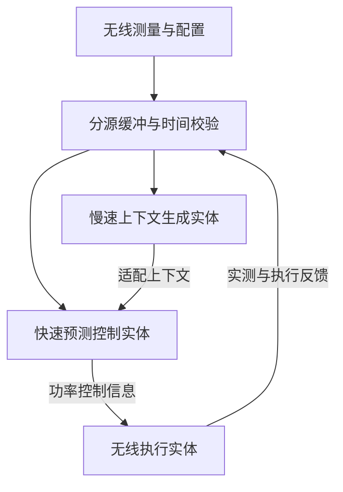
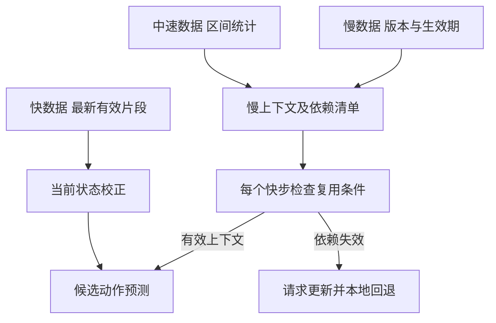
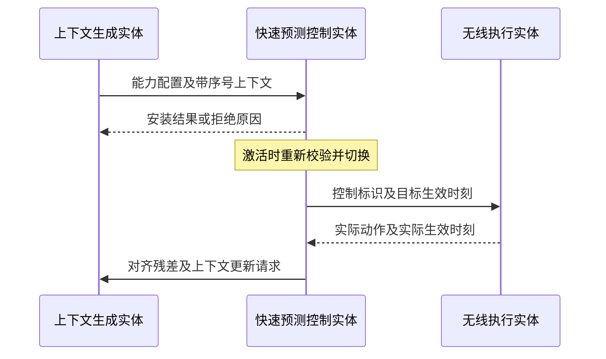
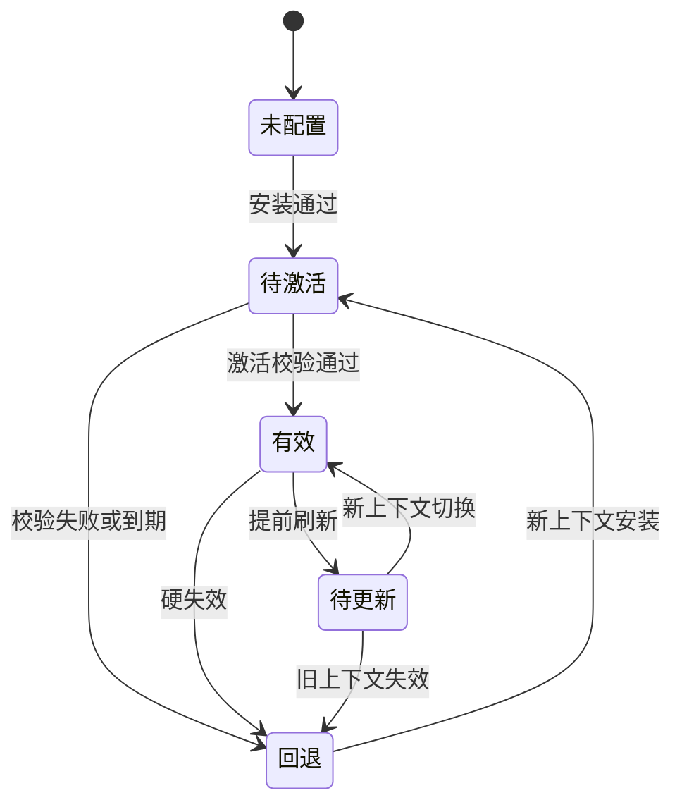
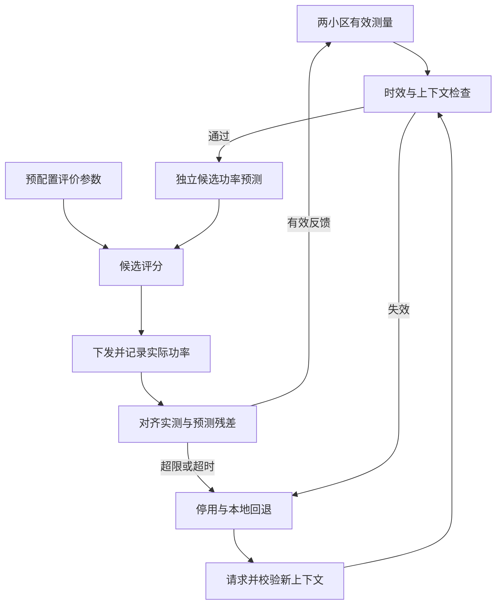

发明专利技术交底书
一种无线接入网多时间尺度数据协同处理与资源控制方法及装置
编制单位：中国移动通信有限公司研究院
修订日期：2026-10-22

# 发明名称
一种无线接入网多时间尺度数据协同处理与资源控制方法及装置。

英文名称：Method and Apparatus for Multi Timescale Data Coordination and Radio Resource Control in a Radio Access Network。

# 申请人信息
| 字段 | 内容 |
|---|---|
| 拟申请人名称 | 中国移动通信有限公司研究院 |
| 申请人类型 | 院内核定 |
| 国籍或注册地 | 院内核定 |
| 统一社会信用代码 | 院内填写 |
| 通讯地址 | 院内填写 |
| 邮政编码 | 院内填写 |
| 联系电话 | 院内填写 |
| 电子邮箱 | 院内填写 |

申请主体及职务发明归属由院内核定。

# 发明人信息
## 第一发明人
| 字段 | 内容 |
|---|---|
| 姓名 |  |
| 国籍 |  |
| 工作单位 |  |
| 职务或职称 |  |
| 通讯地址 |  |
| 邮政编码 |  |
| 联系电话 |  |
| 电子邮箱 |  |

其他发明人：________________。发明人及排序按实际创造性贡献确认。

# 技术领域
本发明涉及无线接入网测量处理、预测辅助资源控制及网络节点协同，尤其涉及不同采样周期的无线数据在共同决策时刻的时效判定、慢速预测上下文与快速状态更新的协同，以及上下文失效后的资源控制。适用于多小区下行功率与干扰协调，可作为面向6G研究的候选技术方案。

# 背景技术
## 无线数据的更新周期与控制周期不一致
多小区功率调整影响服务链路速率、邻区干扰和队列积压。信道测量、队列、负载统计及拓扑配置具有不同采样周期、统计区间和上报时延。直接拼接最近收到的数据，可能把陈旧干扰与新队列误当作同一时刻的状态；将所有数据复制到最快采样率，也不会产生新的有效信息。

## 已有预测控制与缓存方案的适用边界
数字孪生、模型预测控制及分层控制已有状态预测、候选比较和多速率处理能力。每次控制重新处理全部慢变数据存在重复计算；固定周期缓存则可能在测量超龄、邻区配置变化后继续使用失效信息。需要把数据的时间有效性、上下文复用范围与实际执行反馈联系起来，明确何时复用、何时重建以及失效期间如何控制。

## 面向无线接口协同的技术问题
跨节点发送预测上下文时，接收端需要识别无线对象、模型语义、激活时间和有效条件。仅传递模型标识或设置统一有效期，不能表达不同测量的陈旧程度及配置依赖。现有3GPP已有AI/ML数据采集、监测和激活等工作[1]，本方案需与相关机制逐项比较，不以“首次引入无线预测”作为区别。

# 发明内容
## 发明目的
使不同时间尺度的无线观测在保留各自时间属性的条件下共同参与资源控制；在多个快速控制时刻复用有效的慢速上下文，以新测量修正当前状态；在无线适用条件失效时停用上下文并切换本地控制。核心为数据时效、上下文依赖及无线执行的协同处理，业务目标采用预配置评价参数即可完成本方法。

## 技术方案
设置上下文生成实体、快速预测控制实体和无线执行实体三个逻辑功能。快控制周期为Δt，慢速上下文按周期ΔT或物理事件更新；各源采样周期分别为ρ，均为配置量，ΔT无需为Δt的整数倍。控制实体接收或在本地生成上下文，完成以下A至F步骤。

### 技术特征 A 分源记录与因果时间对齐
每条记录包含来源、小区及资源标识、数值与单位、采样时刻或统计区间、到达时刻、采样周期、有效标识和配置版本。按源写入有界时间序列缓冲区，支持事件时间有序索引及重复记录去重；读端在决策时刻t取得不可变快照，写端继续接收。迟到记录可用于后续决策和离线校验，不改写已发出的控制决策。

发送端时刻经已知偏移换算为共同时间τ，时间偏差上界为ε。仅使用已到达且采样结束时刻加ε不晚于t的记录，保守年龄为t−τ+ε。未知时间偏移或误差上界时，将该源标记为时间不可用，不把接收时间当作采样时间。每源配置最大年龄A及必要性标志；采样周期ρ与最大年龄A分别配置。

快变数据选择时效合格的最新值或因果历史片段；中速数据以统计区间、均值、极值或变化量表示；慢变配置按版本和生效区间保持。区间统计保留起止时刻及统计量类型，不当作瞬时值。不使用未来样本插值；可选外推须标注估计来源。缺失或超龄数据置无效掩码，不伪造新时间戳。

### 技术特征 B 按依赖关系协同处理不同速率的数据
慢层从跨源历史、统计摘要及有效配置生成预测器适配上下文；快层用最新有效测量构成当前状态，结合缓存上下文和候选无线动作预测后继状态。配置声明哪些数据进入快状态、哪些进入慢上下文，两者可引用同一源的不同时间范围。处理角色由任务决定，无固定“模态等于速率层”的映射。

上下文记录生成时使用的必要源时间、配置版本、允许变化范围及最大依赖年龄。每个快步重新检查这些依赖：即使某源后来收到新数据，也不能自动刷新旧上下文所依赖样本的时间。新值超出允许变化范围、依赖年龄超限或关键配置版本改变时重建上下文；正常快状态变化在适用域内时继续复用。

### 技术特征 C 预测上下文的配置与激活
预测上下文是供预测器复用的适配信息，不是无线信号调制参数。能力配置确定状态与动作定义、单位、归一化版本、载荷格式、共同时间基准、预测步长和控制预算。上下文携带身份与序号、模型兼容配置、无线作用范围、激活与失效时刻、观测依赖、状态与动作适用域及适配载荷。

控制实体检查完整性、模型语义、张量维度与精度、作用范围及时间条件后安装为待激活对象。按发送实体、会话及作用范围维护已接纳最高序号，拒绝乱序旧包；重启或回绕须重建会话，旧会话包不得激活。同序号同内容幂等确认，同序号异内容拒绝。反馈区分不兼容、超期、乱序、时间不可用和范围不匹配。活动槽与待激活槽分开保存，安装不替换现用上下文。未到激活时刻保持待激活；迟到但未过期的包须重检并记录实际激活时刻。

### 技术特征 D 有效期间的快速预测与资源控制
每次控制校验上下文有效区间、依赖年龄、模型和配置版本、无线对象及残差状态；对每个候选再校验状态与动作适用域，预测终点须在支持时域内。以最新有效实测状态校正起点，分别复制候选的状态和递归记忆。不同候选共用只读上下文，候选A的终态或摘要不得成为候选B的起点。

先过滤单小区功率上限、许可资源及总功率等可直接检查的约束，再预测与评分。在有限可行集合中选择预测评价值最优的配置；未覆盖的候选不评分。无有效候选、推理超时或数值异常时使用预配置本地控制。预测干扰、队列或时延约束依赖预测误差，不作为确定性保障。

控制信息包含控制标识、上下文标识、目标资源、功率值、目标生效时刻和执行期限。输出前复核上下文仍有效且预计执行时刻在有效期内；执行端执行前再检查期限及本地硬约束，拒绝迟到命令，按配置处置失联。支持取消或替换未执行命令；跨节点无法保证瞬时撤销时，以执行期限限制滞留。本地回退同样受明确功率约束；必要测量不可用时执行预配置静态功率方案，不依赖失效预测。

### 技术特征 E 实测反馈驱动的更新与回退
反馈携带控制标识、实际动作、实际生效时间和对应观测区间。仅将已执行动作的预测后继状态与时间对齐的实测后继状态计算残差；按指标尺度归一化，以连续M次或滑动平均超限触发失效。实际动作偏离请求时，使用实际值重算且满足对齐条件后比较，否则标记残差不可用。回执未知、反馈缺失或时间不齐不记零误差；超过监测超时即停用。

设置未配置、待激活、有效、待更新和回退状态。提前刷新时，旧上下文仍有效可继续控制；任何硬失效立即停用。更新请求有截止时刻，慢层未返回不阻塞快环。新上下文通过校验后于激活点原子切换；模型、动作语义或配置不兼容时清空记忆与候选缓存，以有效测量重初始化。恢复需满足较低残差门限或连续合格次数及最小保持时间；可用回退实际动作进行影子预测检查恢复条件。阈值均为待标定配置。

### 技术特征 F 可选模型实现与状态衔接
慢层可采用多模态编码器及预训练语言模型，将数值、年龄、周期和有效掩码编码后生成缩放γ、偏置β和低秩矩阵A、B。快层循环算子G以状态s、动作a、上下文中的外生量c和记忆m递推；d维特征的A、B为d乘r，r小于d。

$$u_t=\gamma\odot\operatorname{SiLU}(W_x[s_t;a_t;c]+b_x)+\beta$$

$$y_t=G_\theta(u_t,m_t)+\operatorname{Norm}(u_t)AB^\mathsf{T}/\sqrt{r}$$

$$s_{t+1}=s_t+W_\delta y_t+b_\delta$$

G可用门控递归单元实现：由归一化输入生成sigmoid衰减系数q和tanh写入值z，以q⊙m+(1−q)⊙z更新记忆，再经门控读出和残差投影输出。该形式为可选实现。离线自由展开可传递预测终态和隐藏摘要；在线以新实测状态校正起点，摘要仅纳入实际执行轨迹及有效观测，不回灌未选择候选的预测。一种具体实现为每次在线决策用有效测量重置状态并清零候选记忆；经验证的历史状态估计器可替代清零。

若采用文本业务目标解析，仅用其输出设置评价权重，物理路径及其缓存不读取该输出；本方法也支持固定权重。仓库现有语言路径在慢速更新中执行物理与语义两个独立前向，快步不调用语言主干。语言模型、双视图、算子共享和固定K均非独立方法的必要限定。

# 附图说明
图1为系统逻辑功能与部署关系；图2为不同时间尺度数据、慢上下文及快状态的协同路径；图3为安装、激活、执行和反馈时序；图4为上下文有效性状态机；图5为多小区功率控制闭环。观测数据、适配上下文和实际无线控制信息分别标注，评价参数仅在候选评分时使用。

# 具体实施方式
## 系统架构
三个逻辑实体可以同址，也可分布在基站与边缘节点。以现有gNB-CU/gNB-DU为兼容部署示例时，按实际接口及预算放置功能，不固定慢层等于CU或快层等于DU。O-RAN为另一工程路径，RIC与CU/DU不作等同。接口承载与信息元素编码需按选定版本适配。

## 实施步骤
### 实施例 1 多小区下行功率与干扰协调
以相邻小区A、B为例，状态包含链路增益、队列及干扰，动作是指定资源集合上的功率。设快控制间隔10 ms，测量周期10 ms、负载统计区间100 ms、拓扑按事件更新，慢上下文计划200 ms刷新；数值仅为实施例配置，不代表6G规定或已测时延。共同时间误差取零；在100 ms决策点，链路测量采样于90 ms且95 ms到达，年龄10 ms；80 ms采样且102 ms到达的邻区报告尚不可用。

若必要链路最大年龄20 ms，90 ms样本可用至110 ms；120 ms仍无合格新测量则回退。90 ms样本如也是慢上下文必要依赖，其最大依赖年龄设50 ms，则上下文最迟在140 ms后失效，即使快状态已收到新测量也不能延长该期限。由此区分“更新当前状态”和“重建慢上下文”。

每小区枚举归一化功率0.1、0.4、0.7，按总功率不超过0.8筛得6个组合；从同一实测起点独立预测，按预配置吞吐、队列和能耗权重评分。向执行实体发送选定配置并记录实际生效值。若只执行一小区请求，则使用两小区实际配置向量；另一值未知时不计算残差，依监测超时回退。物理单位和归一化关系由能力配置明确。

若要求过渡过程的总功率也受限，控制实体先下发减功率并等待实际回执，再分配剩余额度用于增功率；执行端拒绝超出分配额度的命令，回执未知时冻结增功率。候选过滤本身仅保证所枚举向量满足上限。

### 实施例 2 异常时序与恢复
序号8的上下文正在使用，接纳待激活的序号10后收到9，拒绝9且不覆盖10。10激活前发生载波或动作单位变更，则重检失败；若8仍覆盖当前配置则维持8，否则回退。待更新时观测超龄、有效期到达或计算超时，均不等待慢层。模型不兼容、必要观测丢失和反馈不明分别返回对应原因；恢复不沿用旧模型记忆。

### 实施例 3 信息交换与6G标准化适配
以下为拟议功能性信息组，不是已分配的标准消息或信息元素。模型兼容配置须涵盖状态/动作语义、单位、归一化、张量形状、精度和计算语义，仅有ModelID不足以实现跨厂商互通。

| 信息组 | 主要内容 | 接收侧可观察行为 |
|---|---|---|
| 身份与兼容 | 发送实体、会话、ContextID、序号、模型配置 | 拒绝旧包及不兼容载荷 |
| 无线范围与时间 | 小区、载波或BWP、资源、动作域、激活/失效时刻、时间基准 | 限定资源、时域与激活点 |
| 观测依赖 | 必要源、采样/统计时间、最大年龄、配置版本、允许变化范围 | 逐快步校验并按条件停用 |
| 执行与监测 | 控制标识、实际动作、实际生效时间、残差与原因码 | 关联反馈、触发刷新及回退 |

优先研究RAN3相关跨节点时间语义、适用范围及失效行为，结合SA5方向研究模型配置、监测与生命周期管理；具体6G工作项分工需核对。RAN1/RAN2扩展至波束、CSI或测量报告时须另补实施例。管理面不承担每次快环往返。

适配张量传输限于已协商模型兼容的节点；跨厂商可先研究观测、动作、预测结果和生命周期语义，不要求统一内部神经网络。后一路径须另行细化，不自动被适配载荷权利要求覆盖。需与已有监测、激活及预测信息增强比较；本交底不声称已纳入标准或具有标准必要性。

# 技术效果
## 数据与控制时间一致性
保留采样和统计区间、到达时间及最大年龄，避免将迟到数据或旧样本冒充当前观测；逐快步检查上下文生成依赖，避免用新数据时间戳延长旧上下文寿命。依赖失效与动作输出联动，将停用落实到控制流程。

## 计算复用与验证范围
复用有效上下文可减少重复处理慢变信息；总算力、信令开销和业务收益需实测。应在同等观测、动作、约束和预算下，与本地控制、独立轻量预测器、固定周期缓存及事件触发/MPC比较，报告更新次数、传输字节数、过期使用率、控制期限违约率、恢复时间及闭环吞吐、队列、干扰和能耗。

代码基线为d403a7249d97。modalities.py已有年龄、周期、掩码及可选最大年龄处理；foundation.py已有快慢调用、跨窗口年龄递增；planning.py是有限候选单步合成审计。既有三初始化种子合成结果（均值±样本标准差）：轻量模型IID NMSE为−22.24±0.20 dB，独立循环基线为−21.19±0.30 dB；这些结果不验证新增协议、真实无线性能或语言模型无线任务收益。本次未新增训练实验。

## 新增设计与待验证内容
分源并发缓冲、时钟偏移上界、上下文依赖清单、分布式安装与序号规则、实际执行反馈、状态机及回退是本次补充设计，尚未形成完整实现。应注入迟到、丢失、乱序、不兼容、配置突变、执行失败及超时，检查停止复用与恢复。新颖性及原申请支持范围须逐项核对，2026-10-16检索报告不覆盖本次新增组合。

标准参考：[1] 3GPP AI/ML工作综述，2025-02-16，https://www.3gpp.org/news-events/3gpp-news/ai-ml-2025 。[2] 3GPP RAN职责，https://www.3gpp.org/3gpp-groups/radio-access-networks-ran 。2026-10-22核对官方索引；工作组映射为推进建议。

# 权利要求书
## 独立权利要求
以下为技术交底中的候选权利要求，需结合检索与申请支持范围形成正式文本。

1.一种由无线接入网控制设备执行的多时间尺度数据协同处理与资源控制方法，其特征在于：获取至少两个采样周期不同的无线数据源的观测记录，记录包含无线对象、采样时刻或统计区间、到达时刻及有效标识；在控制时刻，根据各源时间属性和最大年龄选取已到达的有效观测，形成当前无线状态；获取由跨源观测及配置生成的预测器适配上下文，所述上下文关联生成所依赖观测的时间、配置版本、最大依赖年龄、无线适用范围及有效区间；在多个快速控制时刻检查所述依赖及有效条件，在条件满足时将上下文与更新后的当前状态及候选无线配置结合，产生预测状态，在满足预设可检验配置约束的候选集合中按评价参数选择并输出控制信息；在依赖超龄、配置不兼容或有效区间届满时停止复用，触发更新并按预配置本地控制规则输出控制信息；其中，新到观测更新当前状态时，不改变既有上下文所关联的生成依赖时间。

2.一种无线接入网控制装置，包括处理器、存储器及通信接口，存储器存储程序，处理器执行程序时通过通信接口获取观测记录、获取预测器适配上下文并输出无线资源控制信息，执行权利要求1所述方法。

## 从属权利要求
3.根据权利要求1所述的方法，其中依据共同时间偏移和误差上界换算采样时间及保守年龄；未知时间关系、未到达、采样结束时间上界晚于控制时刻或超龄的记录不作为有效观测；区间统计保留起止时刻及统计量类型。

4.根据权利要求1所述的方法，其中按源设置有界事件时间缓冲，读端取得不可变快照，写端继续接收；同源重复记录去重，迟到记录用于后续控制或校验，不改写已输出控制信息。

5.根据权利要求1所述的方法，其中分别将快变有效片段用于状态校正、区间统计及生效配置用于上下文生成；必要依赖的新观测超出预设变化范围时触发重建。

6.根据权利要求1所述的方法，其中接收含会话、序号、模型兼容配置、激活与失效时刻的上下文，按会话及作用范围拒绝旧序号，校验后安装为待激活对象，在激活时重检并切换；不兼容时清空递归记忆及候选缓存。

7.根据权利要求1所述的方法，其中从同一经测量校正的状态及独立复制的记忆预测各候选，保持上下文只读，禁止将一个候选的终态或摘要用于另一个候选的起点；在线摘要由实际执行轨迹及有效观测形成。

8.根据权利要求1所述的方法，其中将控制标识关联的实际动作及实际生效时刻与后续实测对齐，按尺度归一化计算残差；连续超限或监测超时触发停用，反馈不明时标记残差不可用，按恢复门限或连续合格次数及最小保持时间恢复。

9.根据权利要求1所述的方法，其中提前请求更新且旧上下文仍有效时继续控制，旧上下文失效时不等待更新而回退；输出前复核上下文、候选适用域和执行期限，并携带供执行端核验的标识及期限。

10.根据权利要求1所述的方法，其中配置为多小区功率，候选受单小区及总功率上限约束；上下文可包括由数值和时间特征生成的缩放、偏置或低秩残差参数，供快速循环预测器复用。

# 说明书摘要
本发明公开一种无线接入网多时间尺度数据协同处理与资源控制方法及装置。按来源保留无线观测的时间属性，在控制时刻选取已到达的有效数据，以新测量校正当前状态；将慢速生成的预测器适配上下文及观测依赖用于多个快速控制时刻的候选资源预测。根据依赖年龄、配置版本和有效区间判定能否复用，新观测不刷新旧上下文依赖时间。对符合约束的候选选择并输出无线控制信息；失效时停止复用、请求更新并进入本地控制，通过实际执行反馈校验预测及恢复条件。该方法用于多小区功率与干扰协调。摘要附图为图1。
